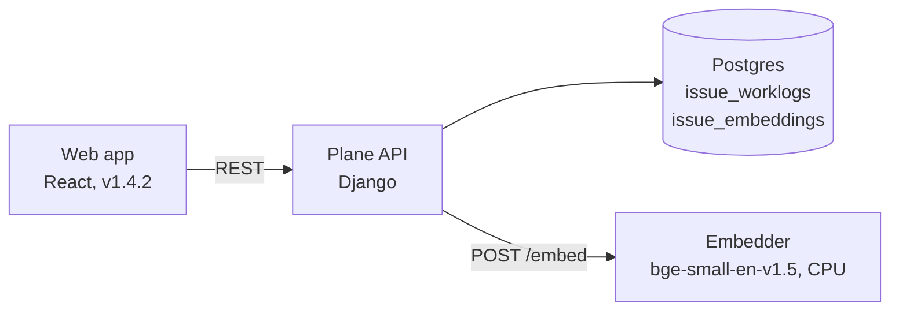

# Plane + Time Tracking & Smart Search

A fork of [Plane](https://github.com/makeplane/plane), the open-source project management tool, extended with three features Plane's community edition doesn't have:

- **Time tracking** on every work item
- **Project timesheets**: hours by person and day
- **Smart search**: find work items by meaning, using an AI model that runs on your own server

Everything is self-hosted. No API keys, and no data leaves the server.

**[See the landing page →](https://prathamesh250205.github.io/plane-time-tracking-search/)** · **[Try the live demo →](https://plane-demo-v6r4p4rw5rxqf54j-80.app.github.dev)** (runs in a GitHub Codespace, so it's only up while the codespace is running)

> Looking for Plane itself? See the [upstream README](https://github.com/makeplane/plane#readme).


## Features

### Time tracking

A **Time logged** row in every work item's sidebar opens a popover where you log time in plain language (`1h 30m`, `1.5h`, `45m`) or with one-click quick picks. It shows the running total, a per-person share bar and the list of entries.

- Only the person who logged an entry can edit or delete it; guests can view but not log
- 1 minute to 24 hours per entry, no future dates; "today" works across time zones


### Timesheet

A **Timesheet** page in each project's menu: a person × day grid for any week, with cells shaded by hours, daily and weekly totals, summary stats and a per-work-item breakdown that links to each item.

### Smart search

A **Smart search** page in each project's menu. Describe what you're looking for in your own words; work items are ranked by meaning, so *"the app feels sluggish"* finds *"Users report slow dashboard"*. The best matches are shown first, and weaker ones sit behind a toggle.


### A livelier interface

The web app uses the **Geist** font and a light motion layer: a slow ambient glow, pages and cards that animate in, 3D cards that tilt toward the cursor with a light glare, and sliding sidebar items with a glowing active marker. It's all plain CSS plus about 30 lines of TypeScript (`styles/globals.css`, `helpers/fx.ts`), and it turns off under the system's "reduce motion" setting.

## How it works



- **Time logs** live in a new `issue_worklogs` table (migration `0126`). The summary endpoint aggregates them by person, by work item and by person-and-day in the database.
- **Search** uses a small separate **embedder** service (`apps/embedder`): about 40 lines of Python around [fastembed](https://github.com/qdrant/fastembed), with the 384-dimension `BAAI/bge-small-en-v1.5` model baked into the image. It's a separate container because Plane's API image is Alpine Linux, which the model's ONNX runtime doesn't support.
- **Embeddings are cached** per work item in `issue_embeddings` (migration `0127`), keyed by a hash of the title and description. Each search embeds only items that are new or changed since the last one, so there are no background jobs to keep in sync.
- **Ranking** is cosine similarity in Python over the project's items. Results within 0.1 of the best score count as "best matches"; that window was tuned by hand for this model.

### API

All endpoints are under `/api/workspaces/<slug>/projects/<project_id>/`.

| Method | Path | What it does |
|---|---|---|
| `GET` / `POST` | `issues/<issue_id>/worklogs/` | List or log time on a work item |
| `PATCH` / `DELETE` | `issues/<issue_id>/worklogs/<id>/` | Edit or delete your own entry |
| `GET` | `worklogs/summary/?cycle_id=&start_date=&end_date=` | Totals by member, by work item and by member-and-day |
| `GET` | `issues/semantic-search/?q=&limit=10` | Work items ranked by meaning (`503` if the embedder is down) |

## Branches

| Branch | Contents |
|---|---|
| `feature/semantic-search` | **Start here.** Backend (time tracking + search), embedder, tests, landing page, this README |
| `feature/semantic-search-v1.4.2` | Web app: Plane v1.4.2 + time tracking UI, Timesheet and Smart search pages, CI workflow |
| `feature/time-tracking` / `feature/time-tracking-v1.4.2` | Earlier snapshots with time tracking only |

The web app is built on Plane's tagged **v1.4.2 release**; the backend follows Plane's development branch.

## Run it locally

You need Docker with Compose. From `deployments/cli/community`:

1. **Configure.** `cp variables.env plane.env`, then set `SECRET_KEY` and `LIVE_SERVER_SECRET_KEY` to random strings. `plane.env` is gitignored.
2. **Build the backend and embedder** (on branch `feature/semantic-search`):
   ```bash
   docker build -f ../../../apps/api/Dockerfile.api -t plane-backend:local ../../../apps/api
   docker build -t plane-embedder:local ../../../apps/embedder
   ```
3. **Get the web image.** Download the `plane-frontend-v142` artifact from the latest [**Build web image**](https://github.com/Pradnesh02/plane/actions/workflows/build-time-tracking-web.yml) run on `feature/semantic-search-v1.4.2`, then load it:
   ```bash
   unzip plane-frontend-v142.zip && docker load < plane-frontend-v142.tar.gz
   ```
   Or build it on Linux from a checkout of that branch: `docker build -f apps/web/Dockerfile.web -t plane-frontend:v142 .` (a Windows checkout produced a bundle with missing translations, so CI builds it on Linux).
4. **Start everything.** Migrations run automatically:
   ```bash
   docker compose -p plane --env-file plane.env -f docker-compose.yml -f docker-compose.local.yml up -d
   ```
5. Open http://localhost.

### Share it publicly (optional)

`bash tunnel.sh` (in `deployments/cli/community`) opens a free [Cloudflare quick tunnel](https://developers.cloudflare.com/cloudflare-one/connections/connect-networks/do-more-with-tunnels/trycloudflare/) and prints a public `https://….trycloudflare.com` link. It also points `WEB_URL` at that link, because Plane redirects there after sign-in. The link works while the machine and Plane are running, and changes on every run. `bash tunnel.sh stop` goes back to localhost only. Consider turning off public sign-up (God mode → Authentication) before sharing a link.

## Tests

- **API:** 16 contract tests, 12 for time tracking and 4 for search. The search tests swap in a fake embedder, so no model is needed. From the repo root:
  ```bash
  docker compose -f docker-compose-test.yml run --rm --build api-tests pytest plane/tests/contract/app/test_issue_worklog_app.py plane/tests/contract/app/test_issue_semantic_search_app.py
  ```
- **Duration parser:** `node --experimental-strip-types apps/web/helpers/worklog.test.ts` (on the `-v1.4.2` branch).
- **CI:** every push to the web branches builds the image on GitHub Actions and checks that English translations, the time tracking UI, the Timesheet page and the Smart search page are all in the bundle.

## Limits and next steps

- **Search scale:** ranking scans the whole project in Python, which is fine up to a few thousand work items. Beyond that, move to [pgvector](https://github.com/pgvector/pgvector) with an index.
- **Search quality:** `bge-small` is small (about 70 MB) and struggles with very short titles; a larger model ranks better at about four times the size. The 0.1 best-match window would need retuning for a different model.
- **First search after a bulk import** embeds every new item, so it's slower than later searches.

## License

[AGPL-3.0](LICENSE.txt), the same as Plane. This is an independent extension and is not affiliated with Plane Software, Inc.
